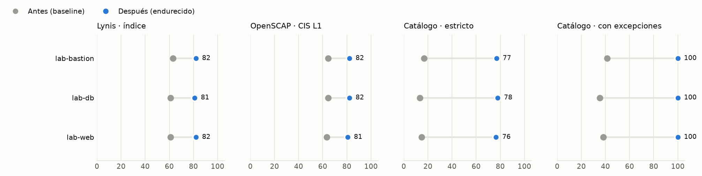
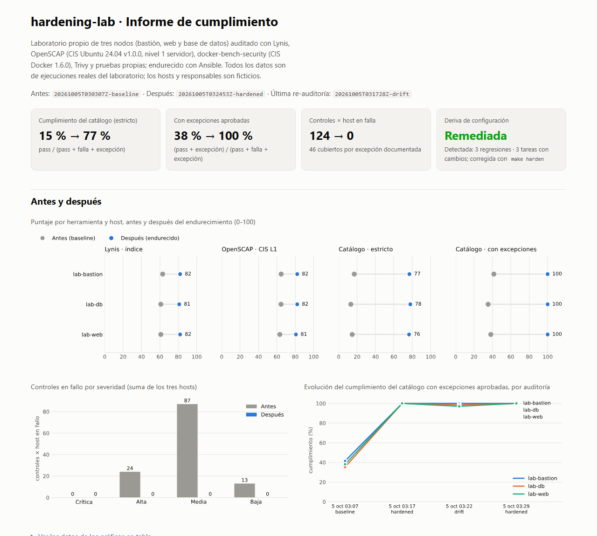
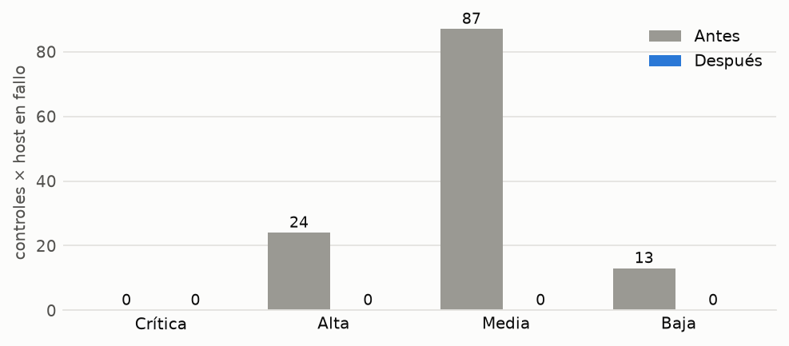
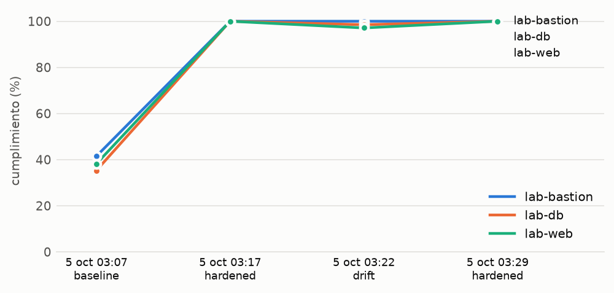
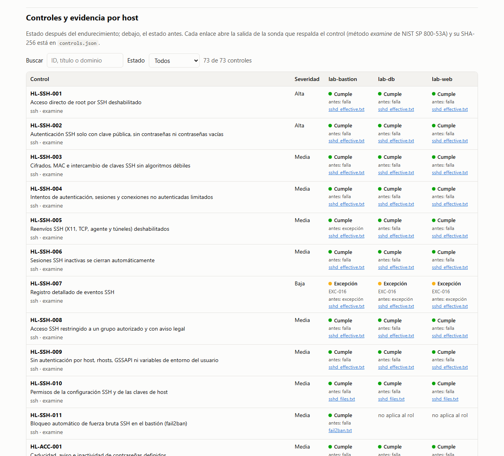
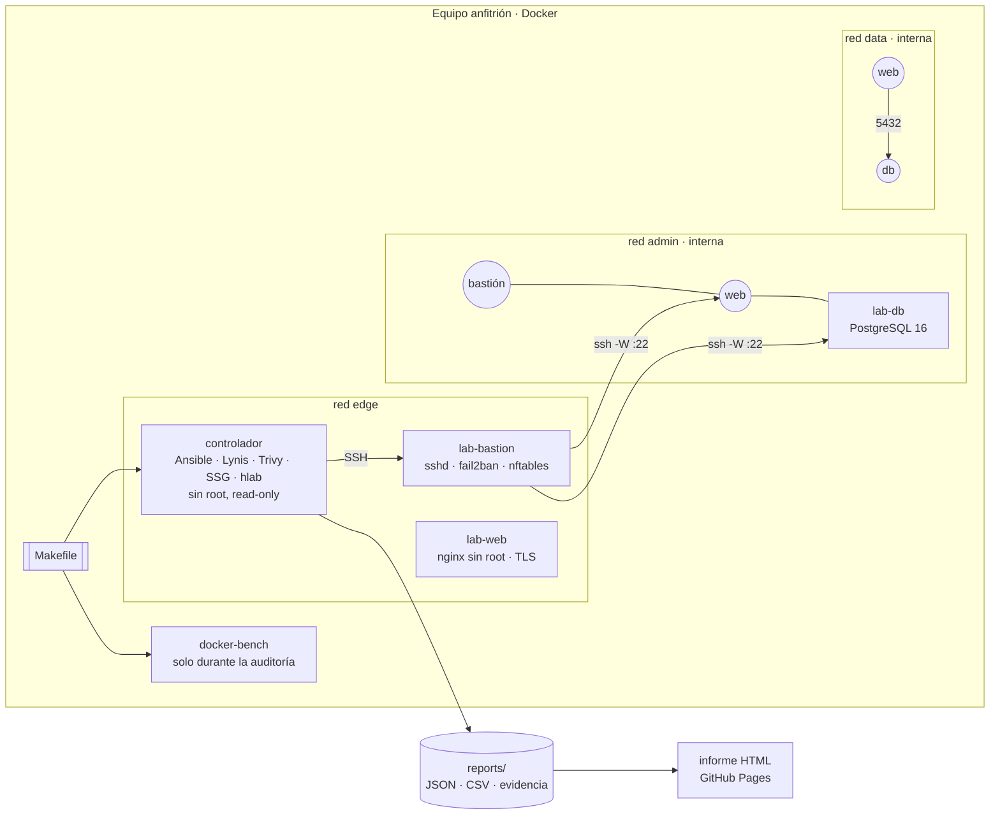
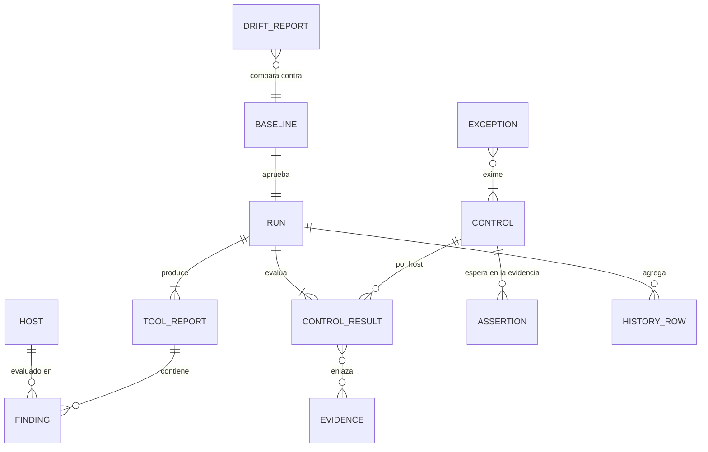

# hardening-lab

Laboratorio reproducible que **mide, endurece y vuelve a medir** tres servidores propios (bastión, web y base de datos)
con Lynis, OpenSCAP (CIS), docker-bench, Trivy y Ansible, y demuestra la mejora con evidencia por control,
excepciones justificadas y detección de deriva.

[](https://github.com/DiegoFranciscoG/hardening-lab/actions/workflows/ci.yml)
[](https://github.com/DiegoFranciscoG/hardening-lab/actions/workflows/drift.yml)


[](https://diegofranciscog.github.io/hardening-lab/)

**Demo en vivo:** [diegofranciscog.github.io/hardening-lab](https://diegofranciscog.github.io/hardening-lab/) — informe
generado por CI en cada push a `main` a partir de una ejecución real del laboratorio. Es un sitio estático: no hay
login ni usuario de prueba.

<picture>
  <source media="(prefers-color-scheme: dark)" srcset="docs/img/puntajes-antes-despues-dark.png">
  
</picture>



## Problema que resuelve

Un "servidor endurecido" casi nunca se puede demostrar: cada herramienta mide distinto, los benchmarks cambian de
versión, lo que no aplica a un contenedor se esconde como "N/A" y nadie vuelve a revisar si alguien cambió algo a mano.
hardening-lab convierte el endurecimiento en un proceso **medible y auditable** (control → evidencia → excepción →
deriva), siguiendo NIST SP 800-53 CM-6, SP 800-53A y SP 800-128, sobre infraestructura que el propio laboratorio crea y
destruye.

## Resultados (ejecución real del laboratorio)

Auditorías del 5 de octubre de 2026 (`reports/runs/`): baseline `20261005T030307Z` → endurecido `20261005T032453Z`.

| Host | Lynis (índice) | OpenSCAP CIS L1 | Catálogo estricto | Catálogo con excepciones | Controles en falla |
|---|---|---|---|---|---|
| lab-bastion | 63 → **82** | 65 → **82** | 17 % → **77 %** | 42 % → **100 %** | 38 → **0** |
| lab-web | 61 → **82** | 63 → **81** | 15 % → **76 %** | 38 % → **100 %** | 42 → **0** |
| lab-db | 61 → **81** | 65 → **82** | 13 % → **78 %** | 35 % → **100 %** | 44 → **0** |

- **124 → 0** controles × host en falla (73 controles en 3 hosts); **46** quedan cubiertos por excepciones justificadas,
  sobre todo responsabilidades del anfitrión, y ninguna herramienta queda en error.
- **Idempotencia**: la segunda pasada de `make harden` termina con `changed=0` en los tres hosts.
- **Deriva**: `make drift-demo` cambió `PermitRootLogin` y los permisos de `/etc/shadow` en lab-web y abrió el
  firewall de lab-db solo en runtime. `make drift` detectó exactamente esas 3 regresiones (HL-SSH-001, HL-PERM-001 y
  HL-FW-001) y 3 tareas de Ansible con cambios; `make harden` las revirtió.

<picture>
  <source media="(prefers-color-scheme: dark)" srcset="docs/img/fallos-por-severidad-dark.png">
  
</picture>
<picture>
  <source media="(prefers-color-scheme: dark)" srcset="docs/img/evolucion-cumplimiento-dark.png">
  
</picture>



## Funcionalidades

- **`make lab-up`**: tres nodos Ubuntu 24.04 (imagen fijada por digest y paquetes desde un snapshot de Ubuntu) con malas
  prácticas típicas de un servidor heredado ([docs/baseline.md](docs/baseline.md)), más un controlador sin root.
- **`make audit`**: Lynis, OpenSCAP con el perfil CIS Level 1 Server, docker-bench (CIS Docker), Trivy (Dockerfiles,
  Ansible y Compose con **checks propios en Rego**), 15 sondas de evidencia por host y pruebas reales de flujos de red.
- **`make harden`**: endurece el runtime de los contenedores (override de Compose) y el sistema operativo con 9 roles
  Ansible propios (SSH, cuentas, sudo y PAM, permisos, servicios, kernel, nftables, fail2ban, nginx y PostgreSQL).
  `make idempotence` exige una segunda pasada con `changed=0`.
- **`make report`**: informe HTML con gráficos antes/después, matriz de 73 controles × host con su evidencia,
  excepciones e historial. En modo claro y oscuro y con CSP.
- **Excepciones justificadas**: 16 desviaciones aprobadas con justificación, control compensatorio y fecha de revisión
  ([docs/excepciones.md](docs/excepciones.md)). Una excepción vencida deja de contar.
- **Detección de deriva**: `make drift` re-audita y compara contra la línea base aprobada (más `ansible --check`);
  `make drift-demo` introduce cambios manuales y demuestra que se detectan. GitHub Actions lo repite cada semana.

## Arquitectura



Flujo de una auditoría: `docker compose config` (Compose efectivo) → docker-bench desde el anfitrión → en el
controlador, Ansible lleva Lynis y el contenido SCAP a cada nodo, ejecuta y trae los resultados, guarda la evidencia y
prueba los flujos de red → Trivy → `ansible --check` → `hlab ingest` normaliza, mapea al catálogo, aplica excepciones y
escribe el run.

## Stack y por qué

| Capa | Tecnología | Motivo |
|---|---|---|
| Laboratorio | Docker Compose v5 + supervisord | Reproducible en cualquier PC con Docker y en el runner de CI. Vagrant queda en el roadmap: no corre en GitHub Actions. |
| Endurecimiento | ansible-core 2.21 (9 roles propios) | Roles etiquetados por control CIS. devsec.hardening (Apache-2.0) sigue sus propias baselines InSpec, no CIS: se usó como referencia. |
| Auditoría | Lynis 3.1.7, OpenSCAP 1.3.9 + SSG 0.1.82, docker-bench-security, Trivy 0.75.0 | Cada una cubre un ángulo distinto (heurística del SO, reglas CIS con severidad, runtime Docker e IaC). |
| Normalización e informe | Python 3.14, pydantic 2, matplotlib, Jinja2, defusedxml | Modelos validados, JSON Schema versionado y XML parseado de forma segura. |
| Calidad | pytest (96 % de cobertura), ruff, mypy estricto, yamllint, ansible-lint (production), hadolint | Mismos chequeos en pre-commit y en CI. |
| CI/CD | GitHub Actions + GitHub Pages | Laboratorio completo en cada push, informe publicado y deriva semanal. Gratis en repos públicos. |

## Modelo de datos

Los informes son archivos versionables (no hay base de datos): JSON por herramienta y ejecución, `controls.json`,
`summary.csv` (control, estado, severidad, fecha) y `history.csv` para graficar la evolución. El detalle, con reglas de
negocio y fuentes, está en [docs/modelo-datos.md](docs/modelo-datos.md); los contratos JSON Schema 2020-12, en
[`schemas/v1`](schemas/v1).



## Cómo ejecutar en local

Requisitos: Docker (Desktop o Engine con Compose v2+), GNU Make y Git Bash en Windows
(`winget install ezwinports.make`). No hace falta instalar Ansible, Lynis ni Trivy: viven en el contenedor controlador.

```bash
make all
```

`make all` equivale a `lab-up` → `audit` (baseline) → `harden` → `audit` (endurecido) → `report`. Tarda ~20 minutos la
primera vez; el informe queda en `reports/site/index.html`.

```bash
make approve-baseline
```

```bash
make drift-demo
```

```bash
make lab-down
```

Sin Docker no es posible: el laboratorio *son* los contenedores. Sí se puede trabajar con los datos ya generados:

```bash
uv sync && uv run hlab report --reports reports --out reports/site
```

`make help` lista todos los objetivos (`ping`, `idempotence`, `drift`, `test`, `lint`…).

## Variables de entorno

No hay secretos: la clave SSH de la automatización se genera en cada `lab-up` dentro de un volumen Docker y se destruye
con `lab-down`. Las variables solo cambian puertos y UID ([.env.example](.env.example)).

| Variable | Descripción | Por defecto |
|---|---|---|
| `LAB_SSH_PORT` | SSH del bastión en `127.0.0.1` | `2222` |
| `LAB_WEB_SSH_PORT` / `LAB_DB_SSH_PORT` | SSH de web/db (solo en el baseline) | `2223` / `2224` |
| `LAB_HTTP_PORT` / `LAB_HTTPS_PORT` | nginx en `127.0.0.1` | `18080` / `18443` |
| `LAB_DB_PORT` | PostgreSQL publicado (solo en el baseline) | `15432` |
| `LAB_UID` / `LAB_GID` | UID/GID del controlador (en Linux, el Makefile usa `id -u`/`id -g`) | `10001` |

## CLI y objetivos

No hay API REST: la interfaz es el `Makefile` y la CLI `hlab`.

| Comando | Qué hace |
|---|---|
| `hlab ingest --run-dir reports/runs/<id> --phase <fase>` | Normaliza las salidas crudas, mapea al catálogo, aplica excepciones y escribe el run (de solo escritura) |
| `hlab report --reports reports --out reports/site` | Genera el informe HTML y los gráficos |
| `hlab baseline approve [--run-id <id>]` | Aprueba una auditoría endurecida como línea base |
| `hlab drift` | Compara la última re-auditoría con la línea base (código de salida 3 si hay deriva) |
| `hlab validate` | Integridad de inventario, catálogo y excepciones |
| `hlab exceptions-doc` · `hlab schemas` | Regeneran `docs/excepciones.md` y `schemas/v1` |

## Tests y cobertura

```bash
make test
```

64 tests (unitarios, parsers contra salidas reales recortadas del laboratorio e integración de ingesta → informe → CLI)
con **96 % de cobertura** (mínimo exigido: 70 %). `make lint` corre ruff y mypy estricto. En CI además se ejecutan
yamllint, ansible-lint (perfil *production*), hadolint, gitleaks y el **laboratorio completo**, incluida la prueba de
idempotencia.

## Despliegue

Todo es gratis:

- **GitHub Actions**: en cada push y pull request ejecuta el lint, los tests, el laboratorio completo y el escaneo de
  secretos; los lunes repite la re-auditoría de deriva. Los workflows programados se desactivan tras 60 días sin
  actividad en el repo, y se reactivan desde la pestaña Actions.
- **GitHub Pages**: publica el informe generado por CI. En *Settings → Pages* hay que elegir la fuente "GitHub Actions".

## Seguridad aplicada

- Alcance ético: solo contenedores propios del laboratorio; nada de exploits ni credenciales reales.
- Herramientas verificadas antes de usarlas:
  - Imágenes base fijadas por digest.
  - Lynis por SHA-256 y SSG por SHA-512.
  - Trivy por **firma Sigstore** y SHA-256 (`scripts/verify-tools.sh`), por el incidente de marzo de 2026.
  - Acciones de GitHub fijadas por SHA y con `permissions` mínimos.
- Mínimo privilegio:
  - Controlador sin root, sin capacidades, con raíz de solo lectura y `no-new-privileges`.
  - Nodos con `cap_drop: [ALL]`.
  - `docker.sock` solo para docker-bench y solo durante la auditoría.
- Puertos solo en `127.0.0.1`; redes `admin` y `data` internas; nftables con denegación por defecto en entrada, reenvío
  y salida.
- XML con `defusedxml`; YAML con `safe_load`; telemetría de Trivy desactivada.
- Detalle completo en [SECURITY.md](SECURITY.md).

## Decisiones técnicas

- **Catálogo propio con ID estable** (`HL-SSH-001`…) en lugar de usar directamente los ID de CIS:
  - CIS renumeró de v1.0.0 a v2.0.0.
  - Las herramientas no comparten identificadores.
  - El catálogo une reglas SSG (por referencia CIS), pruebas de Lynis filtradas por detalle, docker-bench, Trivy,
    aserciones sobre evidencia y pruebas de red. Gana el estado más grave.
- **Contenedor ≠ VM, sin esconder nada**: los nodos instalan `linux-base` y no llevan el marcador `/.dockerenv`, así que
  OpenSCAP los evalúa como servidores completos. Lo que es del anfitrión (auditd, AppArmor, systemd, `ip_forward`) se
  reporta y se cubre con excepciones justificadas.
- **Sin ponderaciones inventadas**: se reporta el puntaje nativo de cada herramienta y un cumplimiento con fórmula
  explícita, estricto y con excepciones. Nunca se suman escalas distintas.
- **Conflictos entre herramientas decididos y documentados**:
  - `ClientAliveCountMax`: gana CIS.
  - `LogLevel VERBOSE` frente a la regla SSG que solo acepta INFO: queda como excepción.
  - `MaxAuthTries 3` y `MaxSessions 2`: satisfacen a CIS y a Lynis a la vez.
- **Runs de solo escritura y deterministas**: reingerir la misma salida da los mismos IDs. Si alguien edita
  `controls.json` a mano, la ingesta falla.
- **Deriva en dos capas**:
  - `ansible --check` detecta cambios en archivos gestionados.
  - La re-auditoría detecta cambios en runtime, como un firewall en `policy accept` aunque el archivo esté intacto.
  - En CI la línea base es la última corrida verde de `main`, en el mismo entorno, para no confundir diferencias de
    kernel con deriva.

## Roadmap

- [ ] Perfil Vagrant/VM para aplicar los controles de kernel, auditd y AppArmor en una máquina completa.
- [ ] Evaluar CIS Ubuntu 24.04 v2.0.0 cuando SSG la publique.
- [ ] Imagen dorada endurecida (Packer o build multi-etapa) con raíz de solo lectura.
- [ ] Firmar las imágenes del laboratorio con cosign y SBOM con Syft.
- [ ] Abrir un issue automáticamente cuando la deriva programada falle.

## Fuentes de datos y licencias

Las 60 fuentes con su fecha de consulta están en [docs/investigacion.md](docs/investigacion.md).

| Componente | Licencia | Uso |
|---|---|---|
| CIS Benchmarks (Ubuntu 24.04, Docker) | CC BY-NC-SA 4.0 | Solo se citan ID; los títulos del catálogo son redacción propia |
| ComplianceAsCode / SCAP Security Guide 0.1.82 | BSD-3-Clause | Se descarga en el build, no se redistribuye |
| Lynis 3.1.7 | GPL-3.0 | Se descarga en el build y se copia temporalmente a los nodos |
| OpenSCAP | LGPL-2.1 | Paquete de Ubuntu en los nodos |
| docker-bench-security | Apache-2.0 | Se construye desde un commit fijado |
| Trivy | Apache-2.0 | Binario verificado por firma y hash |
| fail2ban | GPL-2.0+ | Paquete de Ubuntu en el bastión |
| devsec.hardening | Apache-2.0 | Referencia; no se incluye código |

Hosts, responsables y aprobadores son ficticios; no hay datos personales.

## Autor

**Diego Francisco Granda Zhingre** · [GitHub](https://github.com/DiegoFranciscoG) ·
[LinkedIn](https://www.linkedin.com/in/diego-francisco-g-61b793254/) · [Portafolio](https://diegofranciscog.github.io/)
