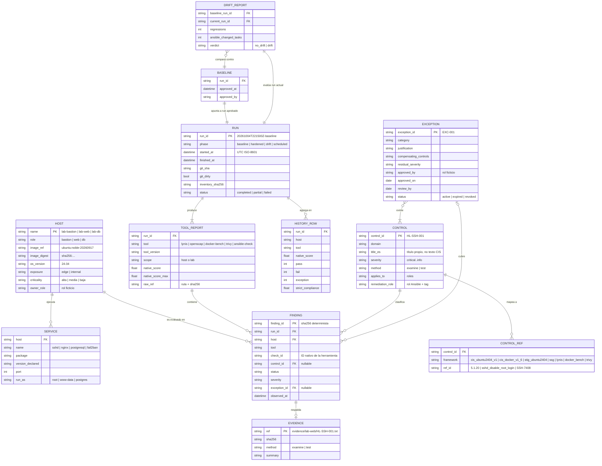

# Modelo de datos

El laboratorio no usa una base de datos relacional: su "base de datos" son **archivos versionables** (YAML de entrada, JSON y CSV de salida) que se pueden revisar en un diff, publicar en GitHub Pages y graficar sin servidor. Las reglas y catálogos salen de [investigacion.md](investigacion.md); el número entre corchetes, p. ej. **[#42]**, remite a la fila de la fuente.

> **Sobre las migraciones:** la regla del portafolio pide Flyway o Alembic, pero ambos migran esquemas de un RDBMS y aquí no hay ninguno. El equivalente es: cada archivo lleva `schema_version`, cada formato tiene su **JSON Schema 2020-12 versionado** en `schemas/v1/`, y si un formato cambia se agrega un migrador numerado e idempotente (`src/hardening_lab/migrations/0001_<cambio>.py`, ejecutado con `hlab migrate`). El MVP arranca en la versión `1.0`.

## 1. Diagrama entidad-relación



## 2. Archivos y ubicación

```text
inventory/lab.yml                         # HOST y SERVICE (inventario Ansible = inventario del laboratorio)
controls/catalog.yml                      # CONTROL y CONTROL_REF
controls/exceptions.yml                   # EXCEPTION (de aquí se genera docs/excepciones.md)
schemas/v1/*.schema.json                  # contrato de cada formato (JSON Schema 2020-12)
reports/
  runs/<run_id>/
    run.json                              # RUN
    raw/<tool>/<host>.<ext>               # salida nativa sin tocar (report.dat, ARF .xml, .json)
    findings/<tool>.json                  # TOOL_REPORT + FINDING normalizados
    evidence/<host>/<control_id>.txt      # EVIDENCE (sondas: sshd -T, nft list ruleset, stat…)
    summary.csv                           # una fila por FINDING
    drift.json                            # DRIFT_REPORT (solo en fases drift/scheduled)
  history.csv                             # HISTORY_ROW, solo se agregan filas
  baseline.json                           # BASELINE: run endurecido aprobado como referencia
  site/                                   # informe HTML generado (no se versiona; se publica en Pages)
```

## 3. Entidades, campos y restricciones

### 3.1 Inventario — `inventory/lab.yml` (formato de inventario YAML de Ansible)

| Entidad | Campo | Tipo | Restricción | Regla / fuente |
|---|---|---|---|---|
| HOST | `name` | string | PK, `^lab-[a-z]+$` | Nombres ficticios del laboratorio; nunca hosts reales. |
| HOST | `role` | enum | `bastion` \| `web` \| `db` | Topología pedida en el MVP. |
| HOST | `image_ref` / `image_digest` | string | tag fijo + `sha256:` | Nunca `:latest` (regla 3 del portafolio) [#51]. |
| HOST | `os_name` / `os_version` | string | `ubuntu` / `24.04` | Hace aplicable el perfil `cis_level1_server` de ubuntu2404 [#4]. |
| HOST | `exposure` | enum | `edge` \| `internal` | Solo `lab-bastion` es `edge`; publica SSH en `127.0.0.1` [#40 regla 5a]. |
| HOST | `criticality` | enum | `alta` \| `media` \| `baja` | Clasificación del laboratorio (dato ficticio). |
| HOST | `owner_role` | string | rol genérico | Ej. "Equipo de plataforma (ficticio)". Sin personas reales (LOPDP). |
| SERVICE | `name`, `package`, `port` | string/int | `port` 1–65535 | sshd 22, nginx 8080, PostgreSQL 5432. |
| SERVICE | `version_declared` | string | versión del paquete en noble | La versión **observada** se captura en cada RUN (hechos de Ansible) y se compara con la declarada. |
| SERVICE | `run_as` | string | usuario del proceso | nginx → `www-data` y PostgreSQL → `postgres` en el estado endurecido [#39, #41]. |

### 3.2 Catálogo de controles — `controls/catalog.yml`

| Campo | Tipo | Restricción | Regla / fuente |
|---|---|---|---|
| `control_id` | string | PK, `^HL-(SSH\|ACC\|SUDO\|PAM\|PERM\|SVC\|NET\|KRN\|FW\|LOG\|AUD\|UPD\|CTR\|WEB\|DB)-\d{3}$` | ID propio estable, independiente de la renumeración CIS v1 → v2 [#1, #3]. |
| `domain` | enum | `ssh`, `accounts`, `sudo_pam`, `file_permissions`, `services`, `kernel_network`, `firewall`, `logging`, `auditing`, `updates`, `container_runtime`, `web`, `database` | Dominios del MVP y de CIS Ubuntu 24.04 [#3]. |
| `title_es` | string | redacción propia | No se copia texto CIS (CC BY-NC-SA) [#6]. |
| `severity` | enum | `critical` \| `high` \| `medium` \| `low` \| `info` | Toma la severidad de la regla SSG/STIG equivalente [#9, #10, S2]. |
| `method` | enum | `examine` \| `test` | Métodos de evaluación de NIST SP 800-53A [#43]. |
| `applies_to` | list[role] | ≥ 1 | Ej. fail2ban solo en `bastion`. |
| `remediation` | objeto | `{role, tags[]}` | Rol Ansible y tag que lo corrige; permite `--tags HL-SSH-001`. |
| `refs[]` | list | `framework` + `ref_id` | `cis_ubuntu2404_v1: 5.1.20`, `ssg: sshd_disable_root_login`, `lynis: SSH-7408`, `cis_docker_v1_6: 5.3`, `trivy: DS-0002`… [#3, #14, #22, #18]. |

### 3.3 Excepciones — `controls/exceptions.yml`

| Campo | Tipo | Restricción | Regla / fuente |
|---|---|---|---|
| `exception_id` | string | PK, `^EXC-\d{3}$` | Identificar la desviación — CM-6(c) [#42]. |
| `control_ids` | list | ≥ 1, deben existir en el catálogo | Integridad referencial validada en tests. |
| `scope` | objeto | `hosts[]` o `roles[]` | Una excepción nunca es global por defecto. |
| `category` | enum | `host_responsibility` \| `not_applicable_container` \| `operational_requirement` \| `risk_accepted` | Ej. auditd → `host_responsibility` [#37]. |
| `justification` | string | ≥ 40 caracteres | Documentar la desviación — CM-6(c) [#42]. |
| `compensating_controls` | list[string] | ≥ 1 salvo `not_applicable_container` | *"controls implemented to mitigate risk"* [#44]. |
| `residual_severity` | enum | igual que `severity` | Riesgo que se acepta. |
| `approved_by` | string | rol ficticio | Aprobar la desviación — CM-6(c) [#42]. |
| `approved_on` / `review_by` | date | `review_by` > `approved_on`, máximo 180 días | Revisión periódica (SUPUESTO de diseño: 180 días). |
| `status` | enum | `active` \| `expired` \| `revoked` | Si hoy > `review_by`, se trata como `expired`. |

### 3.4 Ejecución — `reports/runs/<run_id>/run.json`

| Campo | Tipo | Restricción | Regla / fuente |
|---|---|---|---|
| `run_id` | string | PK, `^\d{8}T\d{6}Z-(baseline\|hardened\|drift\|scheduled)$` | Ordenable por nombre; UTC. |
| `phase` | enum | `baseline` \| `hardened` \| `drift` \| `scheduled` | Antes/después y re-auditorías [#44]. |
| `started_at` / `finished_at` | datetime | ISO-8601 UTC, `finished_at ≥ started_at` | |
| `git_sha` / `git_dirty` | string/bool | 40 hex | Reproducibilidad: qué código produjo el resultado. |
| `inventory_sha256` | string | 64 hex | Qué inventario se evaluó. |
| `tools[]` | list | `{name, version, artifact_sha256}` | Versiones y hashes de las herramientas [#13, #21, #9]. |
| `benchmarks[]` | list | `{name, version}` | Declara "CIS Ubuntu 24.04 **v1.0.0** vía SSG 0.1.82" [#3, hallazgo 4]. |
| `status` | enum | `completed` \| `partial` \| `failed` | `partial` si una herramienta falló; el informe lo muestra. |

### 3.5 Informe por herramienta y hallazgo — `findings/<tool>.json`

| Entidad | Campo | Tipo | Restricción | Regla / fuente |
|---|---|---|---|---|
| TOOL_REPORT | `tool` | enum | `lynis` \| `openscap` \| `docker-bench` \| `trivy` \| `ansible-check` | |
| TOOL_REPORT | `native_score` / `native_score_max` | number | Lynis 0–100 [#14]; OpenSCAP 0–100; docker-bench sin máximo fijo (+1 PASS / −1 WARN) [#23]; Trivy sin puntaje nativo (null) | Se reporta **tal cual**, sin mezclar escalas. |
| TOOL_REPORT | `raw_ref` | objeto | `{path, sha256}` | La salida nativa queda intacta como evidencia [#43]. |
| FINDING | `finding_id` | string | `sha256(run_id\|tool\|host\|check_id\|item)` | Determinista: reingerir el mismo run da el mismo resultado. |
| FINDING | `check_id` | string | ID nativo | `SSH-7408`, `xccdf_org.ssgproject.content_rule_sshd_disable_root_login`, `5.4`, `DS-0002`. |
| FINDING | `control_id` | string | nullable, FK | Si la herramienta no tiene mapeo, el hallazgo igual se reporta (no se esconde nada). |
| FINDING | `status` | enum | ver §4.1 | |
| FINDING | `severity` | enum | ver §4.2 | |
| FINDING | `exception_id` | string | nullable, FK | Solo si existe excepción `active` que cubra control + host. |
| FINDING | `evidence` | objeto | `{summary, ref, sha256}` | Evidencia por control [#43]. |

### 3.6 Resúmenes CSV

**`reports/runs/<run_id>/summary.csv`** — una fila por hallazgo (lo pedido: control, estado, severidad, fecha):

```text
run_id,observed_at,phase,host,tool,check_id,control_id,status,severity,exception_id,evidence_ref
```

**`reports/history.csv`** — una fila por (run, host, herramienta); solo se agregan filas y la clave (`run_id`, `host`, `tool`) es única:

```text
schema_version,run_id,finished_at,phase,git_sha,host,role,tool,tool_version,native_score,pass,fail,exception,notapplicable,notchecked,info,error,critical_fail,high_fail,medium_fail,low_fail,strict_compliance,compliance_with_exceptions
```

### 3.7 Deriva — `reports/baseline.json` y `drift.json`

| Entidad | Campo | Tipo | Restricción | Regla / fuente |
|---|---|---|---|---|
| BASELINE | `run_id` | string | FK a un run `hardened` con `status = completed` | Línea base aprobada [#44]. |
| DRIFT_REPORT | `regressions[]` | list | `{host, tool, check_id, control_id, from, to}` | Ver regla R6. |
| DRIFT_REPORT | `improvements[]`, `new_checks[]`, `missing_checks[]` | list | | Cambios no regresivos, informativos. |
| DRIFT_REPORT | `ansible_changed_tasks[]` | list | `{host, role, task, control_ids}` | Tareas que `--check` cambiaría [#28]. |
| DRIFT_REPORT | `verdict` | enum | `no_drift` \| `drift` | `drift` → código de salida 3 y el job de CI falla. |

## 4. Catálogos normalizados

### 4.1 Estado (`status`)

| Normalizado | OpenSCAP [#15] | Lynis [#14] | docker-bench [#23] | Trivy [#18] | ansible-check [#28] |
|---|---|---|---|---|---|
| `pass` | `pass`, `fixed` | prueba en `tests_executed` sin warning ni suggestion | `PASS` | Success | tarea `ok` |
| `fail` | `fail` | `warning[]` o `suggestion[]` | `WARN` | Failure | tarea `changed` |
| `exception` | *(fail cubierto por excepción activa)* | ídem | ídem | ídem | — |
| `notapplicable` | `notapplicable` | prueba en `tests_skipped` | — | — | tarea `skipped` |
| `notchecked` | `notchecked` | — | `NOTE` (revisión manual) | — | — |
| `info` | `informational` | — | `INFO` | — | — |
| `error` | `error`, `unknown` | — | — | — | tarea `failed` / `unreachable` |

`notselected` (regla fuera del perfil) se descarta y no cuenta.

### 4.2 Severidad (`severity`)

| Normalizado | Origen |
|---|---|
| `critical` | Trivy `CRITICAL` |
| `high` | Trivy `HIGH`; severidad XCCDF `high` (STIG CAT I) [#10, S2] |
| `medium` | Trivy `MEDIUM`; XCCDF `medium` (CAT II); Lynis `warning[]` y docker-bench `WARN` sin mapeo [S3] |
| `low` | Trivy `LOW`; XCCDF `low` (CAT III); Lynis `suggestion[]` sin mapeo [S3] |
| `info` | Trivy `UNKNOWN`; XCCDF `unknown`; estados `info` |

Si el hallazgo tiene `control_id`, **manda la severidad del catálogo**.

## 5. Reglas de negocio

| # | Regla | Fuente |
|---|---|---|
| R1 | Una excepción solo cubre un hallazgo si está `active`, hoy ≤ `review_by` y el host está en su `scope`. Si venció, el hallazgo vuelve a `fail` y el informe lo destaca. | CM-6(c) [#42], SP 800-128 [#44] |
| R2 | Toda excepción tiene justificación y al menos un control compensatorio (salvo `not_applicable_container`). | SP 800-128 [#44] |
| R3 | Todo hallazgo conserva la referencia a su evidencia (salida nativa o sonda) con SHA-256; el informe enlaza la evidencia de cada control. | SP 800-53A [#43] |
| R4 | Un run es de solo escritura: no se modifica después de cerrarse. Reingerir la salida cruda reproduce exactamente los mismos `finding_id`. | Reproducibilidad |
| R5 | `history.csv` solo crece; insertar una clave (`run_id`, `host`, `tool`) repetida es error. | Integridad del historial |
| R6 | **Regresión de deriva** = estado en la línea base ∈ {`pass`, `exception`} y estado actual `fail`, o excepción vencida, o tarea `changed` en `ansible-playbook --check`. Cualquier regresión → `verdict = drift`. | SP 800-128 [#44], Ansible check mode [#28] |
| R7 | Cumplimiento estricto = `pass / (pass + fail + exception)`. Cumplimiento con excepciones = `(pass + exception) / (pass + fail + exception)`. `notapplicable`, `notchecked`, `info` y `error` no entran al denominador; los `error` se muestran aparte porque pueden ocultar fallos. Sin ponderaciones inventadas: se muestran los conteos por severidad. | Decisión de diseño explícita |
| R8 | El informe nunca suma puntajes de herramientas distintas: muestra el puntaje nativo de cada una y el cumplimiento normalizado de R7. | Escalas incompatibles [#14, #23] |
| R9 | Cada informe declara la versión del benchmark evaluado (CIS Ubuntu 24.04 v1.0.0 vía SSG 0.1.82; CIS Docker 1.6.0 vía docker-bench). | Hallazgo 4 [#3, #22] |
| R10 | Fechas en UTC ISO-8601; `run_id` ordenable lexicográficamente. | |
| R11 | Datos 100 % ficticios: hosts `lab-*`, roles genéricos, redes privadas definidas en Compose y claves SSH efímeras generadas en `lab-up` y destruidas en `lab-down` (nunca se versionan). | Regla 3 del portafolio, LOPDP |

## 6. Datos semilla

- **Inventario:** 3 hosts ficticios (`lab-bastion`, `lab-web`, `lab-db`) con sus servicios y versiones de Ubuntu noble.
- **Catálogo:** ~45 controles curados (SSH, cuentas, sudo/PAM, permisos, servicios, red, firewall, logging, actualizaciones, runtime de contenedores, nginx y PostgreSQL) con sus referencias cruzadas.
- **Excepciones:** las derivadas del hallazgo 1 y 2 (auditd, sysctl de kernel, módulos, AppArmor de arranque, systemd/journald, PID 1 root, `no-new-privileges` en nodos, `NET_ADMIN` para nftables, `NOPASSWD` del usuario de automatización), cada una con su compensación.
- **Historial de demostración:** no se inventa. Las filas de `reports/history.csv` publicadas salen de **ejecuciones reales** del laboratorio (baseline → hardened → drift-demo → hardened). Los tests usan fixtures pequeños capturados de esas ejecuciones.
